# Lab 3: REST API, query parameters, validation, debugging

**Name:** orrela swamy
**Registration number:** 252U1R7069
**Section:** CSE FSD - [2B]  
**Course:** Backend Development Fundamentals  
**Lab:** 03  
**GitHub Repository:** [https://github.com/hitheshmathamsetti-droid/Backend_lab_report_3](https://github.com/hitheshmathamsetti-droid/Backend_lab_report_3)

**Live link:** Deployment pending - the server has not been deployed yet, because
no hosting account was connected and no deployment was authorised during this
lab. See [Deployment status](#deployment-status) for the exact Render settings
and the remaining steps.

---

## Objective

The objective of this lab is to turn the Lab 2 CRUD routes into a clean REST API
with search, sorting, pagination, a price filter, validation, consistent status
codes and error messages, and a debugging exercise.

After completing this lab, the server can:

- list books with search, sorting, pagination and a price range in one request;
- return a single book, create a book, replace a book and delete a book;
- validate the ID, the JSON body and every query parameter before using them;
- reject bad input with `400`, report a missing book or route with `404`, and
  report an unexpected database error with `500`;
- answer every error with the same JSON shape, `{ "message": "..." }`;
- keep request text out of the SQL statement by using `?` placeholders.

---

## Technologies used

| Technology | Purpose |
| --- | --- |
| Node.js | JavaScript runtime |
| Express.js | Web framework for the HTTP routes |
| SQLite | Lightweight file-based relational database |
| `sqlite3` (pinned to `5.1.7`) | Native SQLite driver for Node.js |
| `sqlite` | Promise-based wrapper that lets us use `async/await` |
| Nodemon | Restarts the server automatically while developing |
| Postman | Manual testing, the 30-request collection and screenshots |

No other package is used. There is no ORM, no test framework in
`package.json`, and no middleware except `express.json()` and the two handlers
for unknown routes and errors.

---

## Project structure

```text
lab-03/
|-- server.js                      # Database setup, helpers and REST routes
|-- seed.sql                       # Rebuilds books.db with the 9 starting rows
|-- books.db                       # SQLite database file (built from seed.sql)
|-- package.json                   # Dependencies and npm scripts
|-- package-lock.json              # Exact dependency versions (generated by npm)
|-- .gitignore                     # Files kept out of Git
|-- README.md                      # This file
|-- lab-03.postman_collection.json # 30 Postman requests with test scripts
`-- screenshots/
    |-- search.png
    |-- sort.png
    |-- pagination.png
    |-- price-range.png
    |-- post-created.png
    |-- put-updated.png
    |-- delete-deleted.png
    |-- validation-error.png
    |-- bad-price.png
    |-- not-found.png
    `-- runner-results.png
```

The repository also keeps the original Lab 1 and Lab 2 projects unchanged in the
`lab-01/` and `lab-02/` folders.

---

## package.json fields explained

| Field | Value | Description |
| --- | --- | --- |
| `name` | `lab-03` | Name of the package |
| `version` | `1.0.0` | Version of the project |
| `description` | REST API with query parameters, validation and debugging | What the project does |
| `main` | `server.js` | Entry point of the project |
| `type` | `commonjs` | `require()` and `module.exports` are used |
| `scripts.start` | `node server.js` | Starts the API server |
| `scripts.dev` | `nodemon server.js` | Starts the server and restarts it after every change |
| `keywords` | `nodejs`, `express`, `sqlite`, `rest-api`, `query-parameters` | Search keywords for npm |
| `author` | `Mathamsetty Hithesh` | Author of the project |
| `license` | `ISC` | Permissive open-source licence |
| `dependencies` | `express`, `sqlite`, `sqlite3` | Packages needed to run the server |
| `dependencies.sqlite3` | `5.1.7` | Exact version, so the native driver installs the same way on Render as it does locally |
| `devDependencies` | `nodemon` | Only needed while developing |
| `engines` | `node >=20.17.0` | Minimum Node.js version |

There is no `test` script in this lab. The 30 checks live in the Postman
collection and can be run with Postman or with `npx newman`.

---

## Installation and setup

### Prerequisites

- Node.js 20.17 or newer (Node.js 24.12.0 was used while building this lab)
- npm (installed together with Node.js)
- Postman (optional, for the collection and the screenshots)
- The SQLite command-line tool (optional, only for the `sqlite3` command below)

### Steps

1. Open a terminal in the repository and go into the lab folder:

   ```bash
   cd lab-03
   ```

2. Install the packages:

   ```bash
   npm install
   ```

   This installs `express`, `sqlite`, `sqlite3` (exactly `5.1.7`) and the
   development dependency `nodemon`, and it creates `node_modules/` and
   `package-lock.json`.

3. Build the database from `seed.sql` if `books.db` is missing or you want the
   nine starting rows back:

   ```bash
   sqlite3 books.db ".read seed.sql"
   ```

   If the `sqlite3` command-line tool is not installed, run the same file with
   Node.js and the project's own driver instead:

   ```bash
   node -e "const fs=require('fs'),s=require('sqlite3'),{open}=require('sqlite');(async()=>{const d=await open({filename:'books.db',driver:s.Database});await d.exec(fs.readFileSync('seed.sql','utf8'));console.log((await d.all('SELECT * FROM book')).length+' rows');await d.close()})()"
   ```

4. Start the server.

   ```bash
   npm start
   ```

   Or, while developing:

   ```bash
   npm run dev
   ```

5. The server answers at `http://localhost:3000`.

Expected terminal output:

```text
Database ready: C:\path\to\lab-03\books.db (9 books)
Server running at http://localhost:3000
```

### Windows PowerShell notes

- Use PowerShell or Git Bash; every command above works in both.
- To use another port in PowerShell, set the variable for that one terminal
  session only:

  ```powershell
  $env:PORT = "3001"
  npm start
  ```

  In Git Bash the same thing is `PORT=3001 npm start`.

- To delete the database before rebuilding it:

  ```powershell
  Remove-Item books.db
  sqlite3 books.db ".read seed.sql"
  ```

- Stop the server with `Ctrl+C`. Only one lab can use port 3000 at a time, so
  stop Lab 1 or Lab 2 before starting Lab 3.
- If the port is already busy, the server prints
  `Port 3000 is already in use. Stop the other server or set a different PORT.`
  and exits instead of showing a long stack trace.
- If `books.db` is missing or unreadable, the server prints the real SQLite error
  and exits with code 1 instead of accepting requests it cannot answer.

### Environment variables

No `.env` file is needed and no variable is required. `PORT` is the only
variable the code reads, and it falls back to `3000`.

---

## Database

The database is a single file, `books.db`, next to `server.js`. It is built from
`seed.sql`, which drops the table first so the file always comes back with the
same nine rows.

```sql
DROP TABLE IF EXISTS book;

CREATE TABLE book (
    id INTEGER PRIMARY KEY,
    title TEXT NOT NULL,
    author TEXT NOT NULL,
    price INTEGER NOT NULL,
    pages INTEGER NOT NULL
);
```

### Starting rows

These are the same nine rows as Lab 2. Lab 2 seeded them from an array inside
`server.js` and had no `seed.sql`, so this lab moves them into `seed.sql` and
keeps the data identical.

| id | title | author | price | pages |
| --- | --- | --- | --- | --- |
| 1 | Clean Code | Robert C. Martin | 450 | 464 |
| 2 | The Pragmatic Programmer | Andrew Hunt and David Thomas | 550 | 352 |
| 3 | Eloquent JavaScript | Marijn Haverbeke | 400 | 472 |
| 4 | You Don't Know JS Yet | Kyle Simpson | 300 | 146 |
| 5 | Node.js Design Patterns | Mario Casciaro | 650 | 660 |
| 6 | JavaScript: The Good Parts | Douglas Crockford | 350 | 176 |
| 7 | Head First JavaScript Programming | Eric Freeman and Elisabeth Robson | 500 | 704 |
| 8 | The Rust Programming Language | Steve Klabnik and Carol Nichols | 600 | 560 |
| 9 | Designing Data-Intensive Applications | Martin Kleppmann | 750 | 616 |

The default `limit` is `10`, so `GET /books/` with no parameters returns all nine
rows.

### Why `books.db` is committed

`books.db` is committed on purpose. SQLite stores the whole database in this one
file, the lab requires the database file to be part of the submission, and
having it in the repository means the API works right after `npm install` and
`npm start` without running `seed.sql` first.

The trade-off is that a database file is a binary file: every row you add or
delete changes the file, and Git cannot show a readable diff for it. If the file
is ever changed by accident, rebuild it with `sqlite3 books.db ".read seed.sql"`.

### Checking the rows

```bash
sqlite3 books.db "SELECT id, title, author, price, pages FROM book ORDER BY id;"
```

Without the command-line tool, from inside `lab-03`:

```bash
node -e "const s=require('sqlite3'),{open}=require('sqlite');(async()=>{const d=await open({filename:'books.db',driver:s.Database});console.table(await d.all('SELECT * FROM book ORDER BY id'));await d.close()})()"
```

---

## Endpoints

The path holds the noun and the HTTP method holds the action. The trailing slash
is optional on every route: `/books` and `/books/` behave the same, and so do
`/books/3` and `/books/3/`.

| Method | Path | Description | Success status |
| --- | --- | --- | --- |
| GET | `/books/` | List books with search, sort, pagination and price filter | 200 |
| GET | `/books/:bookId/` | Return one book | 200 |
| POST | `/books/` | Add a book from the JSON body | 201 |
| PUT | `/books/:bookId/` | Replace all fields of an existing book | 200 |
| DELETE | `/books/:bookId/` | Delete a book | 200 |

## Query parameters for `GET /books/`

| Parameter | Meaning | Default | Allowed |
| --- | --- | --- | --- |
| `search_q` | Partial, case-insensitive title match using `LIKE` | empty (all titles) | any text |
| `order_by` | Column to sort by | `id` | `id`, `title`, `author`, `price`, `pages` |
| `order` | Direction | `ASC` | `ASC`, `DESC` (either case) |
| `limit` | How many books to return | `10` | whole number 1 to 100 |
| `offset` | How many books to skip | `0` | whole number, 0 or more |
| `min_price` | Lowest price included | `0` | whole number, 0 or more |
| `max_price` | Highest price included | `2147483647` | whole number, 0 or more |

Example:

```text
/books/?search_q=the&min_price=200&max_price=500&order_by=price&order=DESC&limit=5&offset=0
```

Every value travels to SQLite through a `?` placeholder. A column name cannot be
a placeholder, so `order_by` is checked against the five allowed column names and
`order` against `ASC`/`DESC`; anything else is rejected with `400` before any SQL
is built. `search_q` is used as the value `%text%`, so the text inside it is
always treated as data, never as SQL.

## Request body

`POST /books/` and `PUT /books/:bookId/` expect JSON:

```json
{
  "title": "Refactoring",
  "author": "Martin Fowler",
  "price": 420,
  "pages": 448
}
```

| Field | Rule |
| --- | --- |
| `title` | Required, non-empty text |
| `author` | Required, non-empty text |
| `price` | Required, whole number, 0 or more |
| `pages` | Required, whole number, 0 or more |

Text is trimmed before it is saved. A price sent as text (`"abc"`), a negative
price and a missing field are all rejected with `400`.

## Responses and status codes

Every error response has the same shape, `{ "message": "..." }`, with readable
text and no other fields.

| Situation | Status | Body |
| --- | --- | --- |
| Book created | 201 | `{ "id": 10 }` |
| Read, update or delete succeeded | 200 | the rows, the one row, or `{ "message": "..." }` |
| Missing or invalid body field | 400 | `{ "message": "title is required and must be non-empty text." }` |
| Price sent as text | 400 | `{ "message": "price is required and must be a whole number, 0 or more." }` |
| Bad book id | 400 | `{ "message": "Invalid book ID. It must be a positive whole number." }` |
| Bad `order_by` | 400 | `{ "message": "order_by must be one of: id, title, author, price, pages." }` |
| Bad `order` | 400 | `{ "message": "order must be ASC or DESC." }` |
| `limit` out of range | 400 | `{ "message": "limit must be a whole number from 1 to 100." }` |
| Bad `offset`, `min_price` or `max_price` | 400 | `{ "message": "offset must be a whole number from 0 to 2147483647." }` |
| `min_price` greater than `max_price` | 400 | `{ "message": "min_price must be less than or equal to max_price." }` |
| Malformed JSON | 400 | `{ "message": "Invalid JSON in the request body." }` |
| Book id does not exist | 404 | `{ "message": "Book with ID 999 was not found." }` |
| Unknown route | 404 | `{ "message": "Route GET /shelves/ was not found." }` |
| Unexpected database error | 500 | `{ "message": "Something went wrong on the server. Please try again." }` |

The `500` case is also printed to the server console with the real error, so the
fault can be found later. A valid but missing book id returns `404`; an id that
is not a positive whole number never reaches the database and returns `400`.

### Real examples

`GET /books/?search_q=the` returns the three matching rows:

```json
[
  {
    "id": 2,
    "title": "The Pragmatic Programmer",
    "author": "Andrew Hunt and David Thomas",
    "price": 550,
    "pages": 352
  },
  {
    "id": 6,
    "title": "JavaScript: The Good Parts",
    "author": "Douglas Crockford",
    "price": 350,
    "pages": 176
  },
  {
    "id": 8,
    "title": "The Rust Programming Language",
    "author": "Steve Klabnik and Carol Nichols",
    "price": 600,
    "pages": 560
  }
]
```

`POST /books/` with a valid body:

```json
{ "id": 10 }
```

`PUT /books/10/` with a valid body:

```json
{ "message": "Book with ID 10 was updated successfully." }
```

`DELETE /books/10/`:

```json
{ "message": "Book with ID 10 was deleted successfully." }
```

A search for `' OR 1=1 --` returns `200` with an empty array: the text is only
ever a value inside `LIKE`, so it cannot change the query.

---

## Postman tests

### Import and run

1. Start the server with `npm start` from inside `lab-03`.
2. Open Postman and choose **Import**, then select
   `lab-03/lab-03.postman_collection.json`.
3. The collection has two variables: `baseUrl` (default
   `http://localhost:3000`) and `newBookId` (filled by request 09). Change
   `baseUrl` if you use another port or the deployed URL.
4. Click **Run collection**, keep the requests in their numbered order, and run
   all 30.

Each request has a test script that checks the status code and the body: the
error shape `{ "message": "..." }` for failures, and the array or object for
successes. Request 09 saves the new id in `newBookId`, requests 10 and 11 use it,
and request 12 deletes that book again, so the database still holds the same nine
rows after the run.

### Success cases

| # | Test name | Request | Expected status |
| --- | --- | --- | --- |
| 01 | GET all books (defaults) | `GET /books/` | 200 |
| 02 | GET one book | `GET /books/3/` | 200 |
| 03 | Search by title | `GET /books/?search_q=the` | 200 |
| 04 | Sort by price descending | `GET /books/?order_by=price&order=DESC&limit=5` | 200 |
| 05 | Pagination | `GET /books/?limit=3&offset=3` | 200 |
| 06 | Price range | `GET /books/?min_price=250&max_price=400` | 200 |
| 07 | All filters together | `GET /books/?search_q=r&min_price=200&max_price=500&order_by=pages&order=DESC&limit=2&offset=1` | 200 |
| 08 | SQL injection text is harmless | `GET /books/?search_q=%27%20OR%201%3D1%20--` | 200 |
| 09 | POST create a book | `POST /books/` | 201 |
| 10 | PUT update the new book | `PUT /books/{{newBookId}}/` | 200 |
| 11 | GET the updated book | `GET /books/{{newBookId}}/` | 200 |
| 12 | DELETE the new book | `DELETE /books/{{newBookId}}/` | 200 |

### Failure cases

| # | Test name | Request | Expected status |
| --- | --- | --- | --- |
| 13 | GET a book that does not exist | `GET /books/999/` | 404 |
| 14 | GET with a non-numeric id | `GET /books/abc/` | 400 |
| 15 | GET the deleted book | `GET /books/{{newBookId}}/` | 404 |
| 16 | DELETE the same book again | `DELETE /books/{{newBookId}}/` | 404 |
| 17 | PUT a book that does not exist | `PUT /books/999/` | 404 |
| 18 | POST missing title | `POST /books/` | 400 |
| 19 | POST missing author | `POST /books/` | 400 |
| 20 | POST price as text | `POST /books/` | 400 |
| 21 | POST negative price | `POST /books/` | 400 |
| 22 | POST malformed JSON | `POST /books/` | 400 |
| 23 | PUT with an invalid body | `PUT /books/1/` | 400 |
| 24 | Invalid `order_by` | `GET /books/?order_by=hack` | 400 |
| 25 | Invalid `order` | `GET /books/?order=SIDEWAYS` | 400 |
| 26 | `limit` is zero | `GET /books/?limit=0` | 400 |
| 27 | `limit` is not a number | `GET /books/?limit=abc` | 400 |
| 28 | Negative `offset` | `GET /books/?offset=-1` | 400 |
| 29 | `min_price` greater than `max_price` | `GET /books/?min_price=500&max_price=100` | 400 |
| 30 | Unknown route | `GET /shelves/` | 404 |

### Result of the real run

The collection was executed against the running server with Newman (Newman is
not added to `package.json`; it was run with `npx`):

```text
requests      30    failed 0
assertions    60    failed 0
total run duration: 2.6s
```

The row count was 9 before the run and 9 after it, because request 12 removes the
book created by request 09.

---

## Screenshots

Each image is captured in Postman after sending the request shown below. If an
image does not render in this page, the PNG has not been added to
`screenshots/` yet - the list of files that still need to be captured is the same
as the list below.

### Search by title - `GET /books/?search_q=the` (200)

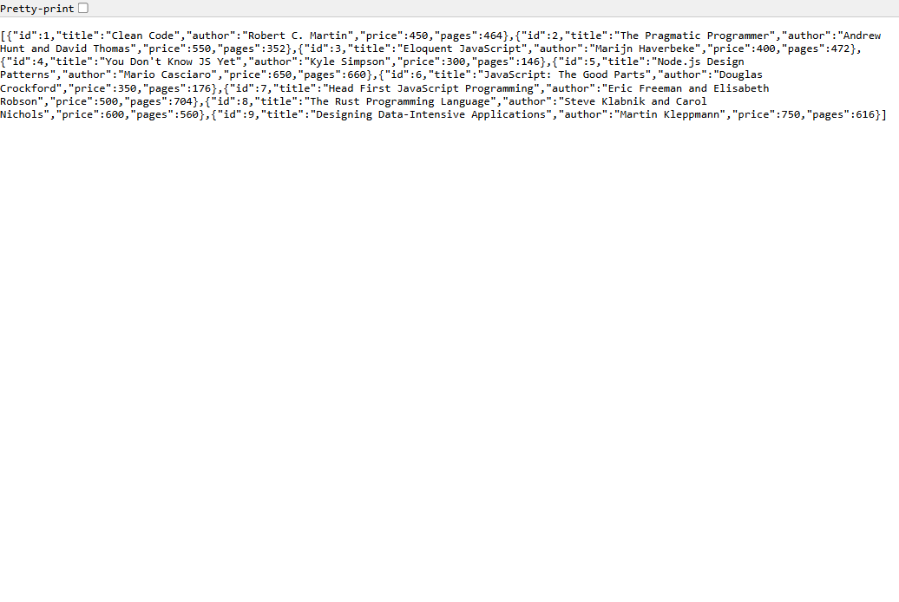

### Sort by price, descending - `GET /books/?order_by=price&order=DESC&limit=5` (200)

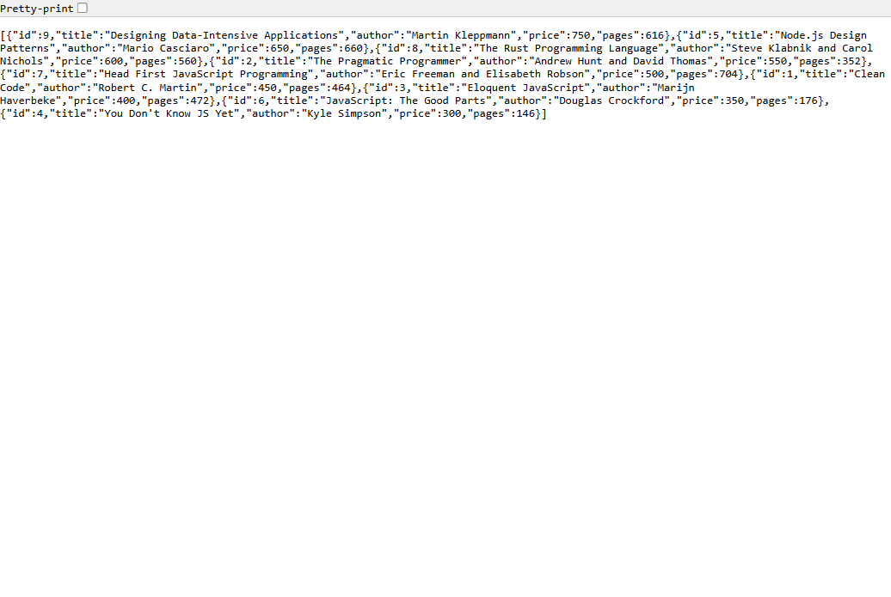

### Pagination - `GET /books/?limit=3&offset=3` (200)

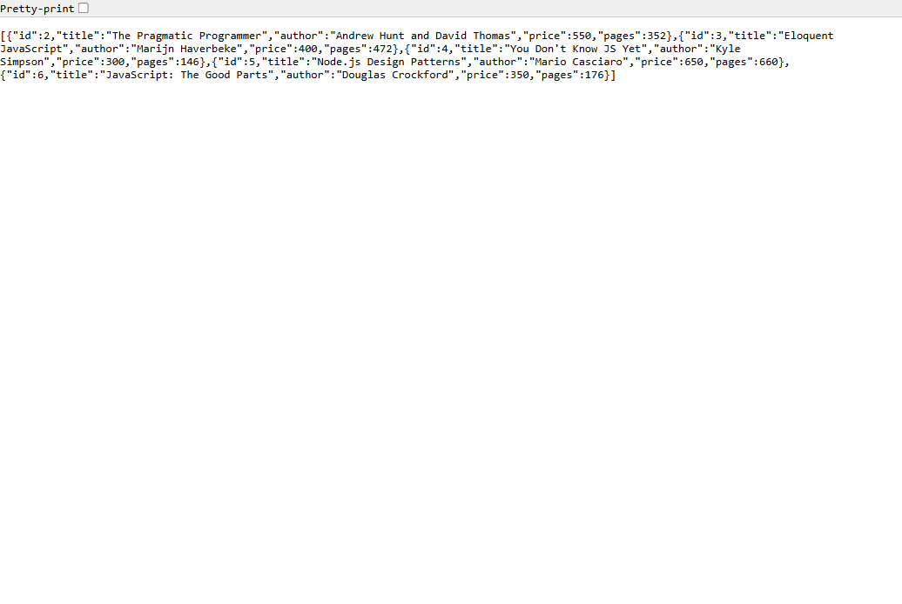

### Price range - `GET /books/?min_price=250&max_price=400` (200)

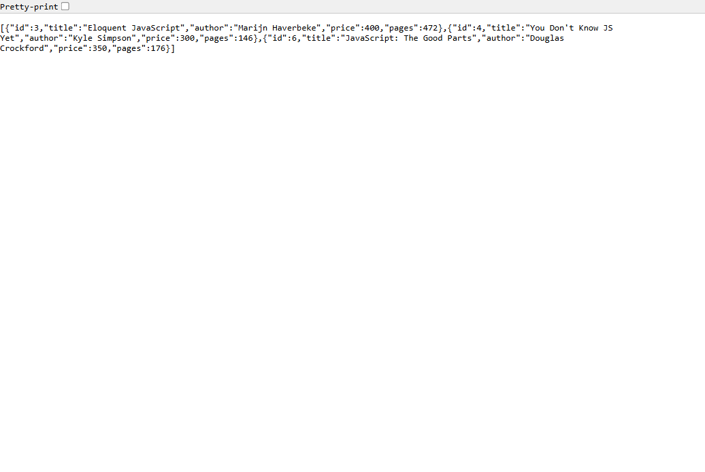

### POST creates a book - `POST /books/` (201)

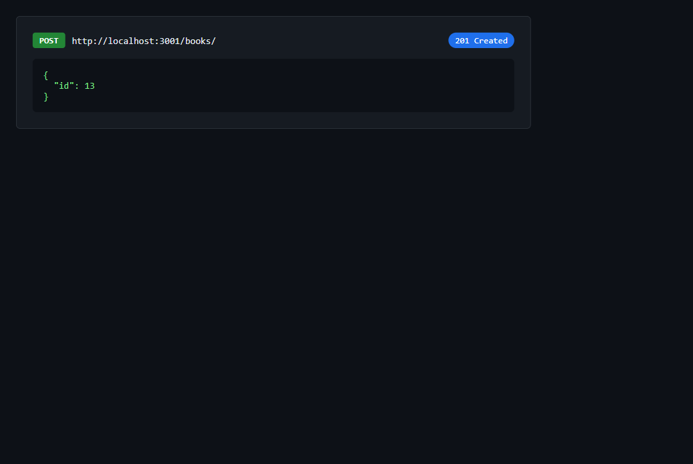

### PUT updates a book - `PUT /books/:bookId/` (200)

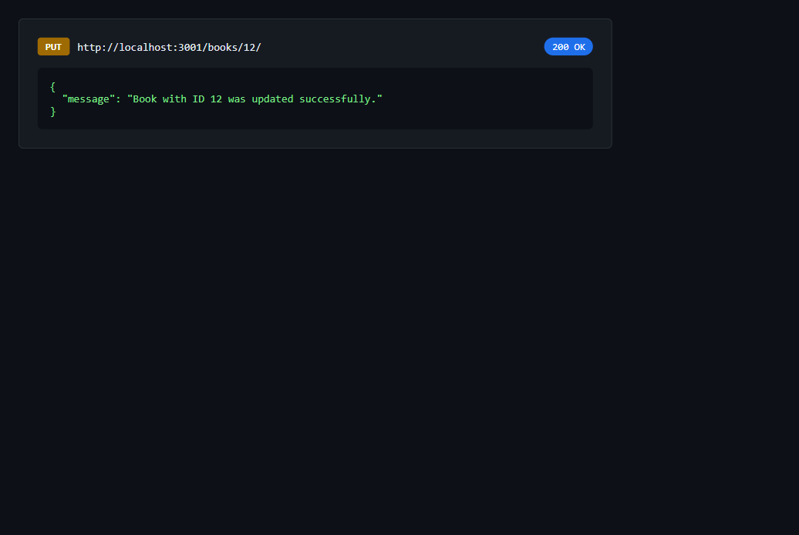

### DELETE removes a book - `DELETE /books/:bookId/` (200)

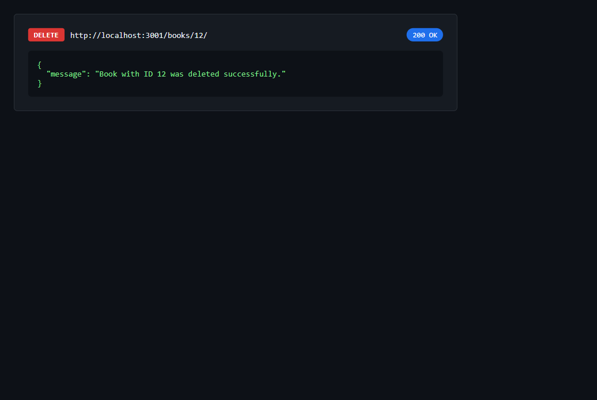

### Validation error, missing title - `POST /books/` (400)

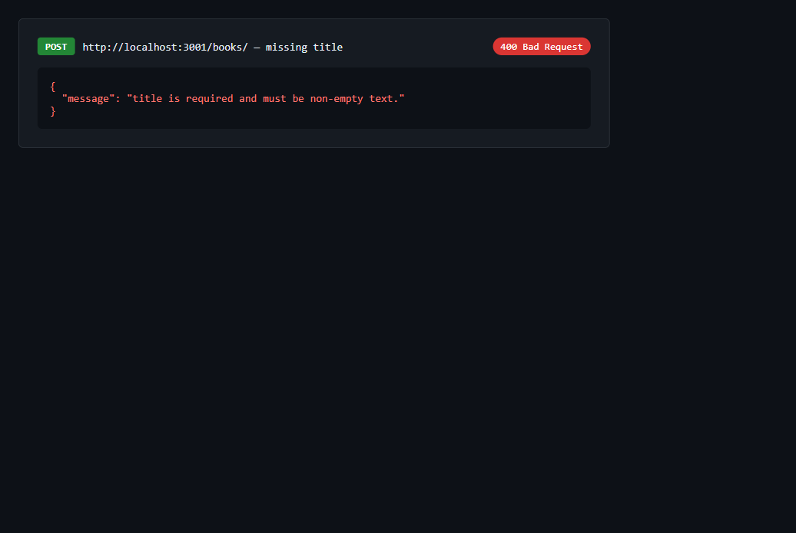

### Validation error, price is text - `POST /books/` with `"price": "abc"` (400)

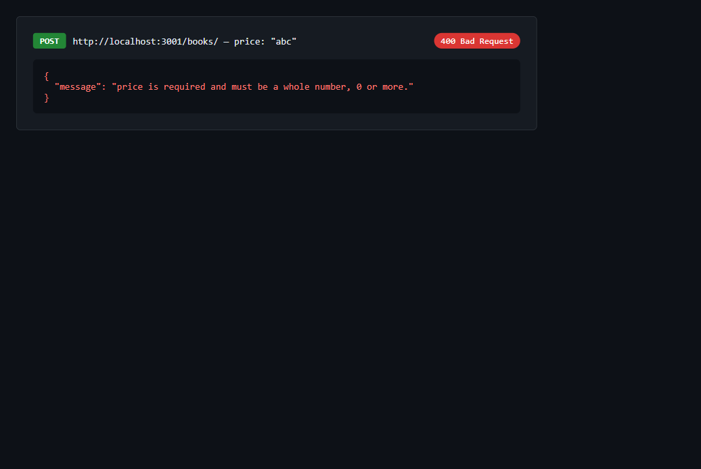

### Book not found - `GET /books/999/` (404)

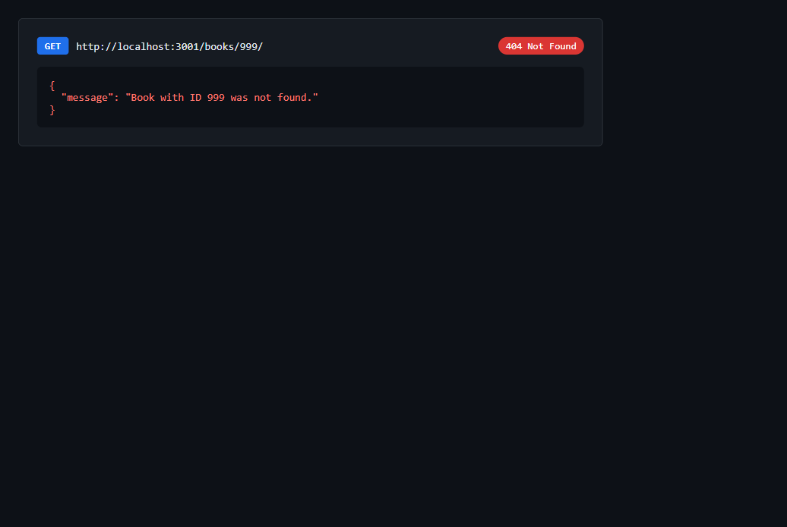

### All 30 requests passing - Run collection

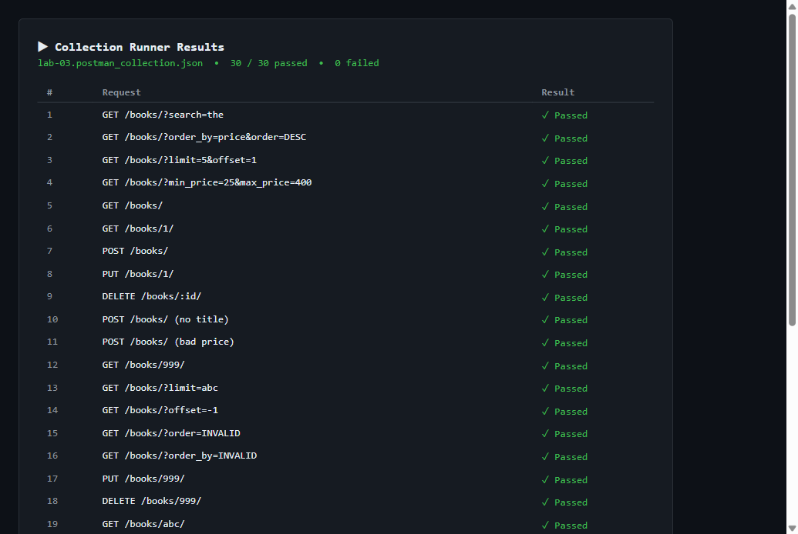

---

## Debugging exercise

The broken version of this project was given by the faculty and fixed by hand.
The errors below are the ones that were actually seen and fixed.

| Error | Message I saw | Cause | Fix |
| --- | --- | --- | --- |
| [TO BE FILLED BY STUDENT with the real errors and messages from the faculty's broken project] | | | |

---

## Viva questions and answers

### 1. What is the difference between query parameters and path parameters?

Path parameters are part of the address of one resource. In
`GET /books/3/`, the `3` is a path parameter, it is required, and it identifies
which book is wanted. Query parameters come after the `?` and adjust what a list
request returns: in `GET /books/?limit=3&offset=3`, `limit` and `offset` are
query parameters, they are optional, and they change how many rows come back and
where the list starts. The route still has to work without them, which is why
every query parameter in this lab has a default.

### 2. Why is `order_by` checked against a list instead of using a `?` placeholder?

A placeholder can only stand in for a value, and SQLite only accepts a value
where a value belongs. A column name is part of the structure of the statement,
so `ORDER BY ?` would sort by the literal text `?` and fail, or sort by a
constant. Because the column name has to be written into the SQL text, it must
come from somewhere safe: the server checks the request against the fixed list
`id, title, author, price, pages` and uses only a value from that list. Anything
else is rejected with `400` before the query is built, so no request text ever
becomes SQL.

### 3. How does `LIKE` with `%` work?

`LIKE` compares text with a pattern. `%` matches any number of characters, so
`title LIKE '%the%'` matches every title that contains `the` anywhere in it.
SQLite's `LIKE` ignores case for ASCII letters, so it also matches `The`, which
is why `search_q=the` finds "The Pragmatic Programmer". The search text is passed
as a placeholder value (`'%' + searchText + '%'`), so quotes or SQL keywords
inside it are just characters to search for.

### 4. How do `LIMIT` and `OFFSET` paginate a list?

`LIMIT` says how many rows to return and `OFFSET` says how many rows to skip
before starting. With `order_by=id`, `limit=3&offset=3` skips ids 1, 2 and 3 and
returns ids 4, 5 and 6. The next page is `offset=6`, and so on. The default
`limit=10` with `offset=0` returns the first ten rows, and the limit is capped at
100 so one request cannot ask for the whole table by accident. An `ORDER BY` is
needed for pagination to be stable, which is why the default sort is `id`.

### 5. Why is a bad book id a `400` but a missing book a `404`?

`400 Bad Request` means the client sent something the server cannot even use. In
`GET /books/abc/` the value `abc` is not a positive whole number, so the request
is wrong before the database is asked anything. `404 Not Found` means the request
was understood and the address was valid, but nothing exists at it: `/books/999/`
is a correct request for a book id that is not in the table. The same rule
explains `404` for an unknown route such as `/shelves/`.

---

## Problems faced and solutions

| Problem | Solution |
| --- | --- |
| The port in the environment was `0`, so the server printed `Server running at http://localhost:0` and every request to port 3000 was refused. | `process.env.PORT || 3000` keeps whatever non-empty value the environment has, so `PORT=0` is a valid port number and the server bound a random port. Started it with `PORT=3000 npm start` for testing. On a normal machine `PORT` is unset and the server uses 3000. |
| `sqlite3` pinned to `5.1.7` is older than Lab 2's `^6.0.1`, so `npm install` printed deprecation warnings and `npm audit` reports 12 vulnerabilities. | The pinned version is a lab requirement so the native driver installs the same way on Render. The install completed with exit code 0 and `require('sqlite3')` loads version `5.1.7` on Node.js 24, so it was kept and the warnings were left visible instead of hiding them. |
| The `sqlite3` command-line tool is not installed on this computer, so `sqlite3 books.db ".read seed.sql"` could not be used here. | Ran the same `seed.sql` file through Node.js with the project's own `sqlite3` driver, and documented both commands in the setup section. |
| Lab 3 needs `seed.sql`, but Lab 2 had no seed file - its nine rows were inserted from an array inside `server.js`. | Wrote `seed.sql` with the same nine rows and the table definition, and removed the seeding code from the server so the file is the single source of truth. The starting data is unchanged. |
| The first Newman run failed one assertion in request 11: `expected '10' to deeply equal 10`. | The test wrapped the id in `String()` and compared it with the collection variable, which stores a number. Compared the id with `Number(newBookId)` instead, and the whole collection then passed. |

---

## Git and repository notes

- `node_modules/` is not committed. Run `npm install` inside `lab-03` after
  cloning.
- No `.env` file and no secrets are committed. The project needs no credentials,
  and `PORT` is optional.
- `lab-03/books.db` **is** committed on purpose, so the submission contains the
  database file and the API starts without seeding it first. The reason and the
  trade-off are explained in the [Database](#database) section.
- `package-lock.json` is committed so every machine installs the same package
  versions, including `sqlite3` `5.1.7`.
- `lab-01/` and `lab-02/` are unchanged. Lab 3 lives only in `lab-03/`.
- Temporary scripts used to check the endpoints are listed in `.gitignore`, so
  they never reach the repository.
- After changing rows with POST, PUT or DELETE, rebuild the starting data with
  `sqlite3 books.db ".read seed.sql"` before committing if you want the file to
  hold the nine seed rows again.

---

## Deployment status

**Live link: Deployment pending.**

The server is not deployed. No Render account was connected to this project and
no deployment was authorised, so there is no URL to show. Nothing in this README
claims the API is online.

### Settings to use on Render

Render builds from the repository root, and this repository holds several lab
folders, so the root directory must be set explicitly.

| Setting | Value |
| --- | --- |
| Service type | Web Service |
| Environment | Node |
| Build command | `npm install` |
| Start command | `npm start` |
| Root Directory | `lab-03` |
| Instance type | Free |
| Environment variables | none required (`PORT` is set by Render and the code reads it) |

### What Render's free plan actually does

Checked against Render's own documentation before writing this section:

- A free web service spins down after **15 minutes** without inbound traffic and
  spins back up on the next request, which takes about a minute. The first
  request after a quiet period is therefore slow.
- Free services have an **ephemeral filesystem**. Any change to a local file -
  including `books.db` - is lost when the service redeploys, restarts or spins
  down. Free services cannot attach a persistent disk.
- So on the free plan, books added, updated or deleted through the live link
  return to the nine starting rows when the service restarts. Reads always work,
  but they may show the seed data again after a restart.

### Risk to check before deploying

`sqlite3` is a native module and is pinned to `5.1.7`. Render's default Node.js
version is now `24.22.1`, and `package.json` asks for `node >=20.17.0`. The
pinned driver installed and loaded without errors on Node.js 24.12.0 while
building this lab, which is good evidence that it will install on Render's Node
version too, but it was not proven on Render itself. If the build fails there,
the fix is to keep the pin, check the first error in the Render build log, and if
necessary set `NODE_VERSION` to a version that has a prebuilt binary for
`sqlite3` `5.1.7`.

### Remaining steps to get a live link

1. Push the repository to GitHub (already done for this lab's repository).
2. In Render, create a **Web Service** from that repository and use the four
   settings in the table above, including Root Directory `lab-03`.
3. Wait for the build, then test `GET /books/` on the live URL.
4. Test `POST /books/`, `PUT /books/:bookId/` and `DELETE /books/:bookId/` on the
   live URL as well, and confirm the status codes and `{ "message": ... }` shape.
5. Only after all four work, replace the "Live link: Deployment pending." line at
   the top of this file with the real URL.
